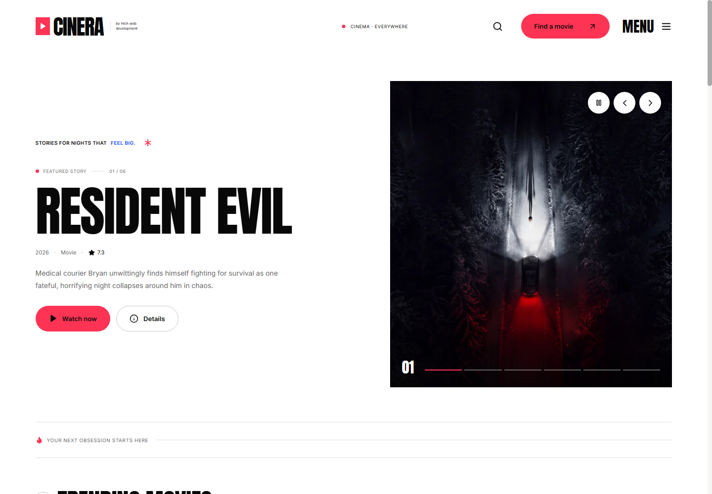
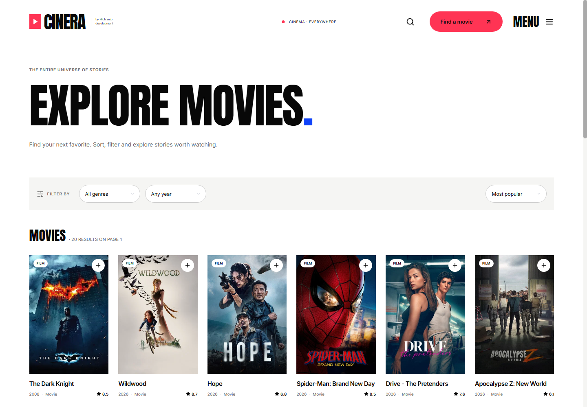
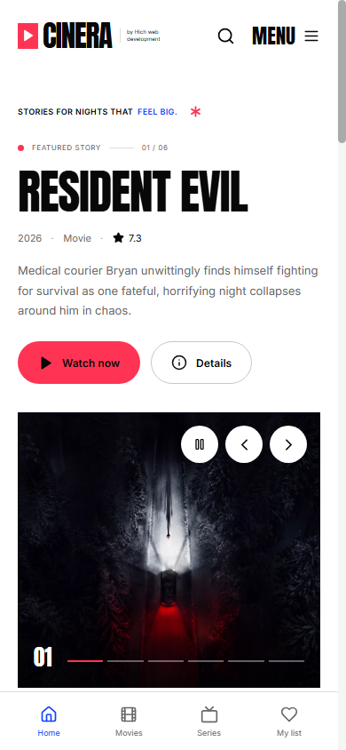

# CINERA — cinematic movie / TV catalog + player

A responsive, full-stack movie discovery portal inspired by the **layout patterns** of popular dark streaming sites. Independent branding; not an official HydraHD product.

## Screenshots

### Home



### Movie catalog



### Mobile

<p align="center">
  
</p>

## Features

- Responsive cinematic landing page with featured hero slides
- Movies, TV, trending, top rated and popular sections
- TMDB-powered catalog, titles, ratings, artwork, cast, trailers and recommendations
- Movies and TV series discover pages with genre, release year, sorting and pagination
- Search titles, including movie and series results
- Detailed movie pages and TV seasons / episodes
- First-party player for selectable direct MP4 and HLS sources
- Optional Vidy iframe fallback with the permissions required by its external player
- Add your own **licensed** MP4/HLS sources in `worker/sources.js`
- Cloudflare Worker API, edge-cached catalog responses and globally distributed static assets
- SPA route fallback, security headers and Cloudflare Workers observability
- Watchlist, recent titles and playback progress stored in browser localStorage, no login needed
- QR phone remote with live D-pad, navigation, playback, volume and fullscreen controls
- Voice search and a random “Surprise me” discovery action
- Sleep timer, Picture-in-Picture, Data Saver and autoplay-next preferences
- Start Over, native sharing, keyboard shortcut guide and editable watch history
- TMDB viewing-provider links where available
- Fallback demo catalog when TMDB credentials are not configured

## Requirements

Node.js **20.19+** (Node 22 recommended) and npm.

## Start locally

```bash
npm install
cp .dev.vars.example .dev.vars
# Edit .dev.vars — fill TMDB_READ_ACCESS_TOKEN for the full catalog.
npm run dev
```

Open **http://localhost:5173**. On Windows PowerShell use `Copy-Item .dev.vars.example .dev.vars` instead of `cp`.

### Production preview

```bash
npm run build
npm run preview
```

The preview uses Cloudflare's local Workers runtime and serves the SPA and API together at **http://localhost:4173**.

## TMDB API

Create an API Read Access Token at <https://www.themoviedb.org/settings/api> and add it to `.dev.vars` for local development:

```env
TMDB_READ_ACCESS_TOKEN=your_token_here
ENABLE_VIDY=true
```

For Cloudflare production, store `TMDB_READ_ACCESS_TOKEN` as a Worker secret in **Settings → Variables and Secrets**. Never add it to `wrangler.jsonc` or frontend code. With no token, the Worker safely serves a small sample catalog.

For TMDB commercial use, review TMDB's terms. TMDB supplies **metadata and artwork**, **not video streaming rights or complete video files**.

## Playback providers

When `ENABLE_VIDY=true`, Cinera adds Vidy as an external iframe fallback for movies and individual TV episodes. Vidy does not function inside a restricted iframe sandbox, so the embed is loaded without a `sandbox` attribute. Vidy controls the content and browser actions initiated inside its frame, including advertising, pop-ups, availability, and licensing; Cinera cannot remove or verify those elements.

Direct HTTPS MP4/HLS sources configured in `worker/sources.js` are preferred over Vidy. For titles without any available source, the watch page shows regional legal-provider options from TMDB and an official trailer when available. TMDB catalog metadata does not include full movie files.

### Self-hosted or licensed streams

Edit `worker/sources.js`:

```js
export const playbackSources = {
  'movie:10378': [
    {
      id: 'licensed-file-1',
      label: 'My MP4 server',
      type: 'video',
      url: 'https://your-cdn.example.com/authorized-film.mp4',
    }
  ],
  'tv:1396': [
    {
      id: 'your-licensed-tv-source',
      label: 'My streaming provider',
      type: 'hls',
      url: 'https://your-cdn.example.com/playlist.m3u8',
    }
  ]
};
```

Note: the example TV entry above is illustrative; you must **have rights** to stream the title. For TV sources that differ by episode, use keys such as `tv:1396:1:1` (TMDB ID, season, episode). These episode-specific sources are combined with any generic `tv:1396` sources. Do not accidentally use a single TV playlist for every episode.

A playable Big Buck Bunny sample is included for testing. The sample is openly licensed; attribution to Blender Foundation.

If a video server blocks cross-origin requests, fix its CORS headers **on the server that you control**; the Cinera frontend cannot bypass these protections.

## API routes

- `GET /api/health`
- `GET /api/home`
- `GET /api/search?q=...&page=1`
- `GET /api/genres/movie` / `GET /api/genres/tv`
- `GET /api/browse/movie?page=1&sort=popularity.desc&genre=28&year=2024`
- `GET /api/title/movie/157336`
- `GET /api/season/1396/1`
- `GET /api/sources/movie/157336`
- `GET /api/sources/tv/1396?season=1&episode=1`
- `GET /api/remote/socket?pair=...&role=screen|remote` (WebSocket upgrade)

## Deploy to Cloudflare Workers

### Wrangler CLI

```bash
npx wrangler login
npm run deploy
```

`npm run deploy` builds the app and uploads values from the ignored local `.env` file as encrypted Worker secrets. The configured Worker name is `cinera-by-hich`, matching the current production URL. Add a production custom domain under **Workers & Pages → cinera-by-hich → Settings → Domains & Routes**.

The QR remote uses the configured `RemoteSession` SQLite-backed Durable Object. Its binding and first migration are already declared in `wrangler.jsonc`; Wrangler creates the namespace on the first deployment.

### Automatic GitHub deployments

Connect this repository under **Cloudflare Workers & Pages → Create → Import a repository**, then use:

- Production branch: `main`
- Build command: `npm run build`
- Deploy command: `npx wrangler deploy`

Add `TMDB_READ_ACCESS_TOKEN` as a **runtime secret** in the Worker's Variables and Secrets settings. Set `ENABLE_VIDY=false` to deploy without the external fallback.

### Validation

```bash
npm run validate
```

This checks the Worker source, runs deterministic API tests, builds the optimized client and Worker bundles, validates static asset routing, and performs a Wrangler dry-run without deploying.

## Notes and limitations

- Movie catalog ≠ movie files. TMDB provides metadata only.
- Vidy is an independent external provider. Its playback availability, advertising, and content licensing are outside Cinera's control.
- You are responsible for the rights and availability of configured media sources.
- Watch progress is saved locally when the selected player reports it.
- Saved lists are per browser/device (no cloud login).
- Do not use copyrighted logo artwork or pretend to be affiliated with HydraHD or TMDB.
