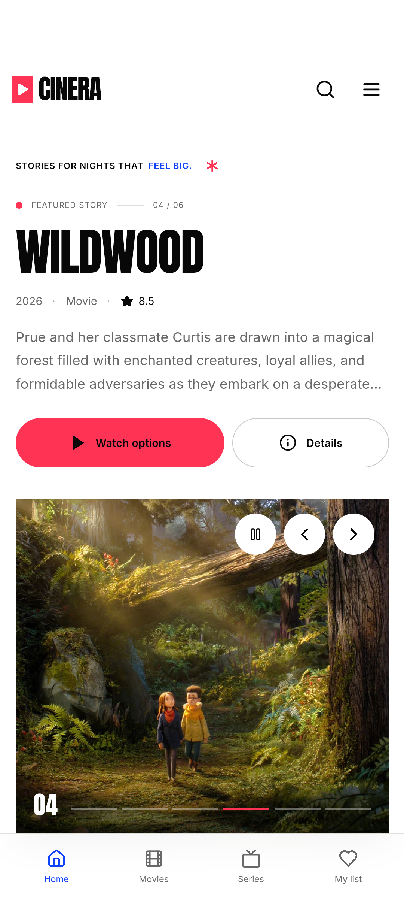
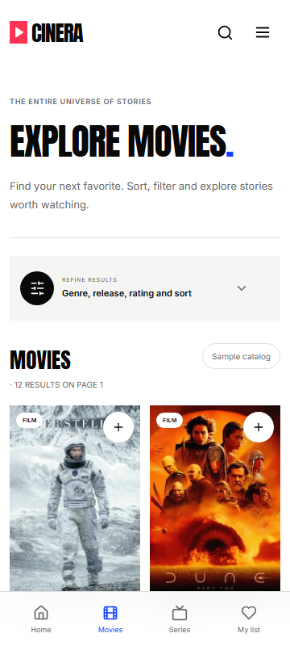
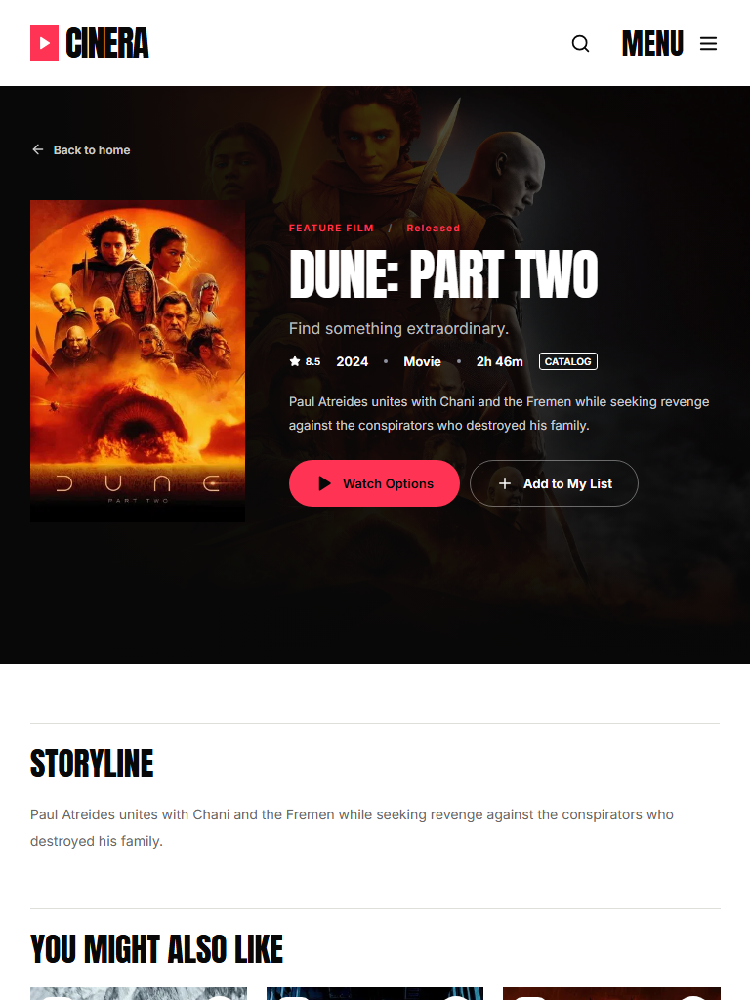
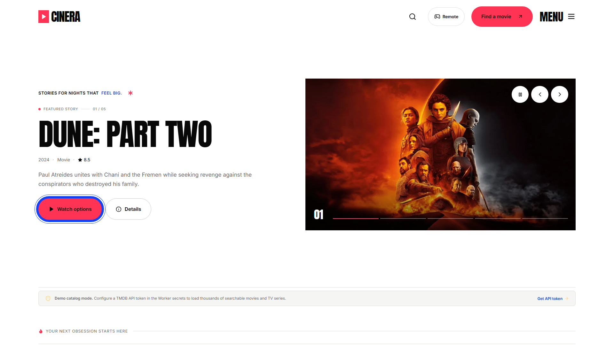
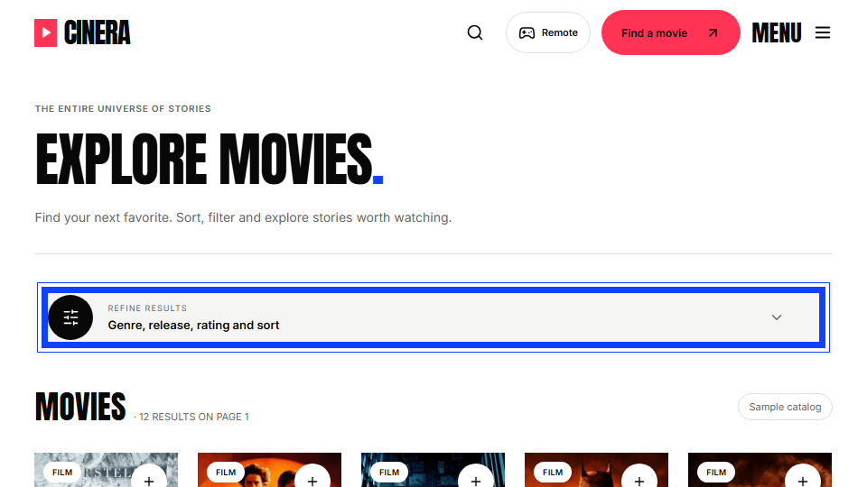
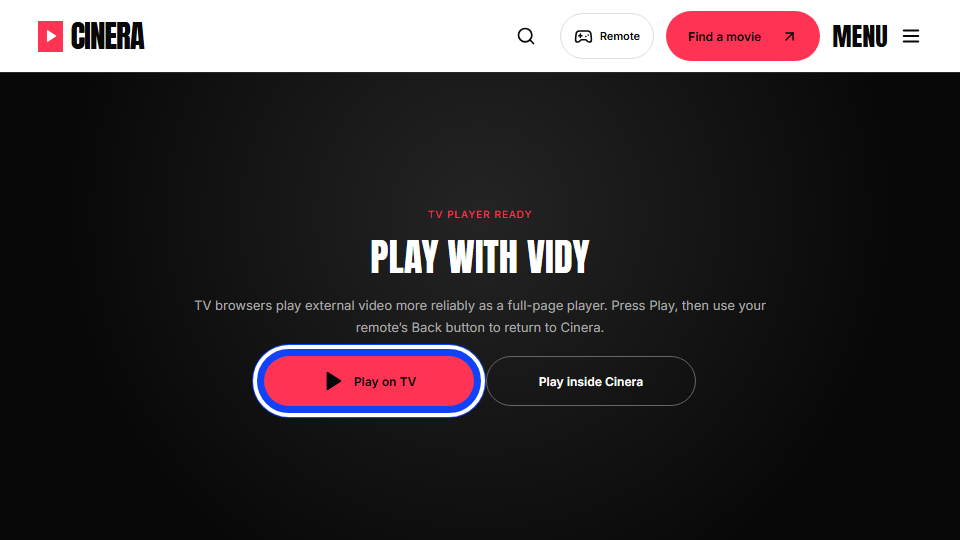
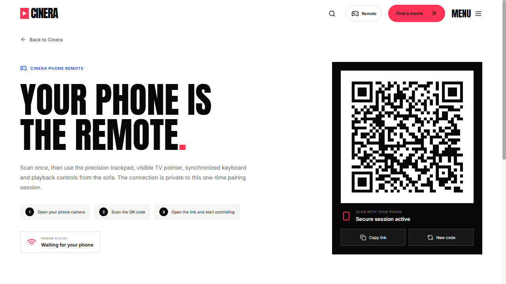
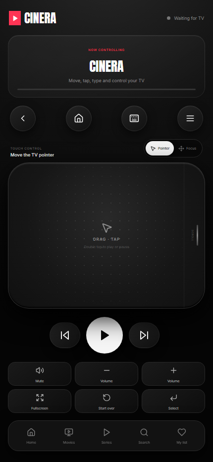
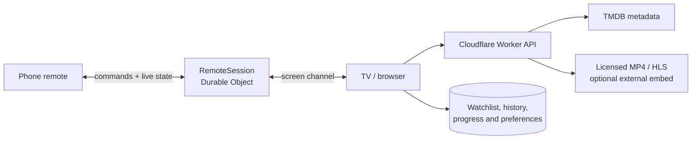

<div align="center">
  
  <h1>CINERA</h1>
  <p><strong>A cinematic movie and TV experience for phones, browsers, and Android TV.</strong></p>
  <p>Discover a title, choose a playback source, and control the room from your phone.</p>

  <p>
    <a href="releases/Cinera-Android-TV.apk"><strong>Download APK v1.1.0</strong></a>
    ·
    <a href="https://cinera-by-hich.hiranthadiass4.workers.dev/"><strong>Open the live app</strong></a>
    ·
    <a href="#quick-start">Run locally</a>
    ·
    <a href="#phone-remote">Phone remote</a>
    ·
    <a href="#deployment">Deploy</a>
  </p>

  <p>
    
    
    
    
    
    
  </p>
</div>

<p align="center">
  
</p>

## Download and verify the Android APK

The APK committed to this repository is the same universal phone, tablet and Android TV build described by the source under [`android/`](android/). It is intentionally documented so you can inspect it before installing it.

| Release fact | Value |
| --- | --- |
| APK | [`releases/Cinera-Android-TV.apk`](releases/Cinera-Android-TV.apk) |
| Version | `1.1.0-debug` (`versionCode 2`) |
| Android package | `com.hichweb.cinera.debug` |
| Compatibility | Android 5.0+ (`minSdk 21`), targeted to Android 15 (`targetSdk 35`) |
| Size | 28,113 bytes |
| SHA-256 | `03AEDE72996D77BF2D6C9993953CCC15F59DA85B3D3731A908C782C6CEF7A56D` |
| Signing | Android debug certificate; APK Signature Scheme v1 and v2 verified |
| Live service | [`cinera-by-hich.hiranthadiass4.workers.dev`](https://cinera-by-hich.hiranthadiass4.workers.dev/) |

Verify the downloaded file yourself in PowerShell:

```powershell
Get-FileHash .\Cinera-Android-TV.apk -Algorithm SHA256
```

With Android SDK Build Tools installed, you can also inspect its signature and manifest:

```powershell
apksigner verify --verbose --print-certs .\Cinera-Android-TV.apk
aapt dump badging .\Cinera-Android-TV.apk
```

### What the APK can access

| Permission | Why it exists |
| --- | --- |
| Internet | Loads the Cinera web interface, catalog artwork, metadata and configured playback sources. |
| Network state | Detects connectivity and presents the retry screen when the service cannot load. |
| Microphone | Optional voice search only. Android asks at runtime; denying it does not block browsing or playback. |

The manifest does **not** request camera, contacts, SMS, phone, location, broad file-storage or accessibility permissions. See the exact declarations in [`AndroidManifest.xml`](android/app/src/main/AndroidManifest.xml) and the native behavior in [`MainActivity.java`](android/app/src/main/java/com/hichweb/cinera/MainActivity.java).

### Trust and transparency

- Cinera is a small native WebView shell around the public HTTPS app above; it requires an internet connection for the live catalog.
- Watchlist, search history, preferences and playback progress stay in WebView local storage on the device. There is no Cinera user account or password collection.
- Phone/TV remote messages pass through a temporary Cloudflare Durable Object WebSocket session and are relayed only between the paired screen and remote.
- There is no custom advertising or analytics SDK in the APK. Cloudflare may process standard request metadata for hosting and operational logs.
- External playback providers are separate services and may have their own content, advertising, privacy and licensing policies. Cinera labels external playback before opening it.
- This APK is debug-signed for transparent sideload testing, not Play Store distribution. Android may show an “unknown source” warning; verify the checksum and source first. A production store release must use a private release key.

Read the full [`Privacy notice`](PRIVACY.md), [`Security policy`](SECURITY.md), and [`Android build instructions`](android/README.md). Sideload only software you have reviewed and trust.

## Real release screenshots

These images were captured from the v1.1 build and its responsive release layouts. Live catalog titles and artwork can change as TMDB updates.

<table>
  <tr>
    <th>Android phone home</th>
    <th>Phone catalog</th>
  </tr>
  <tr>
    <td align="center"></td>
    <td align="center"></td>
  </tr>
</table>

<p align="center">
  
</p>

<table>
  <tr>
    <th>Android TV home — 1080p</th>
    <th>Remote focus — 960×540 TV viewport</th>
  </tr>
  <tr>
    <td></td>
    <td></td>
  </tr>
</table>

<p align="center">
  
</p>

## The experience

Cinera is a full-stack streaming portal focused on a clean ten-foot experience. The interface adapts from touch phones to desktop browsers and remote-controlled TV screens without splitting the product into separate apps.

| Discover | Watch | Control | Continue |
| --- | --- | --- | --- |
| Search, filters, moods, trending rows, cast, trailers, and recommendations. | Select licensed MP4/HLS sources or an optional external fallback. | Pair a phone by QR and use a trackpad, TV pointer, keyboard, and playback controls. | Keep a watchlist, history, preferences, and playback progress locally without an account. |

## A remote built for the sofa

<table>
  <tr>
    <td width="62%">
      
    </td>
    <td width="38%" valign="top">
      <h3>One QR. One private session.</h3>
      <p>The TV creates a temporary pairing code. The phone joins the same Cloudflare Durable Object session and exchanges live commands and screen state over WebSockets.</p>
      <p><strong>No account, Bluetooth, or shared Wi-Fi discovery is required.</strong></p>
    </td>
  </tr>
</table>

<a id="phone-remote"></a>
<table>
  <tr>
    <td width="35%" align="center">
      
    </td>
    <td width="65%" valign="top">
      <h3>Phone remote</h3>
      <p>A restrained, Apple-TV-inspired controller designed for one-handed use.</p>
      <ul>
        <li><strong>Pointer mode</strong> moves a visible cursor and highlights selectable TV elements.</li>
        <li><strong>Focus mode</strong> turns directional swipes into accelerated TV navigation.</li>
        <li>Tap selects, double-tap toggles playback, long-press confirms, and the edge rail scrolls.</li>
        <li>The synchronized keyboard opens automatically when a TV text field receives focus.</li>
        <li>Playback, volume, mute, fullscreen, restart, menu, and section shortcuts remain one tap away.</li>
        <li>Supported browsers receive lightweight haptic feedback for movement and actions.</li>
      </ul>
    </td>
  </tr>
</table>

> The Remote entry is shown only on confirmed TV devices. It remains hidden on phones, tablets, and desktop browsers, including large landscape touch screens.

## Catalog, without the clutter

<p align="center">
  
</p>

The catalog uses TMDB metadata for discovery while keeping playback providers separate. Movies and series can be filtered by genre, year, period, rating, and popularity. Search includes live suggestions, recent terms, voice input where available, and full result pages.

## Feature map

| Area | Included |
| --- | --- |
| Home | Featured stories, editorial rows, continue watching, Surprise Me |
| Discovery | Movies, series, genres, years, ratings, sorting, pagination |
| Search | Live suggestions, voice search, recent searches, mixed title results |
| Details | Metadata, cast, seasons, episodes, trailers, recommendations, provider links |
| Playback | MP4, HLS, iframe sources, server failover, resume progress, Data Saver |
| Player tools | Start Over, sleep timer, Picture-in-Picture, autoplay next, sharing, shortcuts |
| Personal | Watchlist, editable history, playback progress, local preferences |
| TV | Large ten-foot layout, spatial focus navigation, Android/LG/Tizen remote keys, legacy browser fallback |
| Adaptive screens | Safe-area phone navigation, touch-friendly tablet grids, 960p/1080p TV scaling, short-screen player mode |
| Phone remote | QR pairing, trackpad, cursor, focus gestures, keyboard, haptics, playback controls |
| PWA | Installable manifest, offline shell, cache rotation, mobile home-screen support |

## Architecture



| Layer | Technology | Responsibility |
| --- | --- | --- |
| Interface | React 18, React Router, Lucide | Responsive UI, routes, search, watch and remote experiences |
| Playback | Native video, HLS.js, iframe integration | Direct streams, adaptive HLS, external fallback |
| Edge API | Cloudflare Workers | Catalog normalization, source selection, caching, security headers |
| Remote relay | Durable Objects WebSockets | Isolated screen/phone sessions, presence and command relay |
| Data | TMDB API plus local sample catalog | Metadata, art, seasons, discovery and credential-free fallback |
| Client storage | `localStorage` and `sessionStorage` | Watch state and short-lived remote pairing tokens |

## Quick start

### Requirements

- Node.js 20.19 or newer; Node.js 22 is recommended
- npm
- Optional TMDB API Read Access Token for the full catalog

### macOS / Linux

```bash
npm install
cp .dev.vars.example .dev.vars
npm run dev
```

### Windows PowerShell

```powershell
npm install
Copy-Item .dev.vars.example .dev.vars
npm run dev
```

Open <http://localhost:5173>. Without TMDB credentials, Cinera starts with a safe sample catalog so the complete interface remains testable.

### Android and Android TV APK

The repository now includes a universal native Android shell in [`android/`](android/README.md). It adds Android TV launcher support, D-pad and media-key handling, native Back behavior, fullscreen video, immersive mode, secure external-link routing, voice-search permission handling, and an offline recovery screen while retaining the deployed Worker API and phone-remote sessions.

```powershell
cd android
.\gradlew.bat clean :app:assembleDebug
```

The debug build is signed automatically and can be sideloaded on both Android phones and Android TV devices. Version 1.1 adds device-specific phone, tablet and TV layouts plus primary-action remote autofocus. See [`android/README.md`](android/README.md) for ADB installation and production-signing instructions.

The prepared v1.1 APK is available directly at [`releases/Cinera-Android-TV.apk`](releases/Cinera-Android-TV.apk).

### Local environment

```env
TMDB_READ_ACCESS_TOKEN=your_token_here
ENABLE_VIDY=true
```

| Variable | Required | Purpose |
| --- | --- | --- |
| `TMDB_READ_ACCESS_TOKEN` | No | Enables the complete TMDB catalog; sample data is used when absent |
| `ENABLE_VIDY` | No | Enables or disables the optional external iframe fallback |

Never commit `.env`, `.dev.vars`, API tokens, or account credentials.

## Playback sources

Direct HTTPS MP4 and HLS sources in `worker/sources.js` are preferred. Configure only media you are authorized to distribute.

On detected TV browsers, the optional Vidy fallback offers a remote-friendly full-page launch first. This avoids the autoplay and focus restrictions that many Android TV and webOS browsers apply to cross-origin iframes; the remote Back button returns to Cinera. An in-page embed remains available as a fallback.

```js
export const playbackSources = {
  'movie:10378': [
    {
      id: 'licensed-file-1',
      label: 'Primary CDN',
      type: 'video',
      url: 'https://cdn.example.com/authorized-film.mp4',
    },
  ],
  'tv:1396:1:1': [
    {
      id: 'licensed-episode-1',
      label: 'Adaptive HLS',
      type: 'hls',
      url: 'https://cdn.example.com/season-1/episode-1/master.m3u8',
    },
  ],
};
```

Episode-specific keys use `tv:{tmdbId}:{season}:{episode}`. Generic `tv:{tmdbId}` sources can be used only when the same authorized stream is intentionally shared across episodes.

The included Big Buck Bunny source is an openly licensed playback sample. If your own server blocks cross-origin requests, configure CORS or framing permissions on that server; the frontend does not bypass them.

## API reference

| Method | Route | Purpose |
| --- | --- | --- |
| `GET` | `/api/health` | Runtime and catalog health |
| `GET` | `/api/home` | Featured titles and home rows |
| `GET` | `/api/search?q=...&page=1` | Mixed movie and series search |
| `GET` | `/api/genres/:kind` | Genre catalog for `movie` or `tv` |
| `GET` | `/api/browse/:kind` | Filtered and paginated discovery |
| `GET` | `/api/title/:kind/:id` | Normalized title details |
| `GET` | `/api/season/{id}/{season}` | TV season and episode data |
| `GET` | `/api/sources/:kind/:id` | Direct and external playback choices |
| `WS` | `/api/remote/socket` | Private relay using `pair` and `role` parameters |

## Project structure

```text
cinera_app/
├── public/                 PWA assets, security headers and service worker
├── src/
│   ├── components/         Search, player, cards, layout and watch tools
│   ├── lib/                API, state, PWA, TV navigation and remote logic
│   └── pages/              Home, browse, details, watch, pairing and remote
├── test/                   Worker, player, TV and gesture tests
├── worker/
│   ├── catalog.js          TMDB and sample catalog normalization
│   ├── sources.js          Authorized playback source configuration
│   └── index.js            API routes and Durable Object relay
├── wrangler.jsonc          Worker, assets and Durable Object configuration
└── vite.config.js          React and Cloudflare build integration
```

## Validation

```bash
npm run validate
```

The validation pipeline checks Worker syntax, runs deterministic tests, builds the production client and Worker bundles, validates asset routing, and performs a Wrangler deployment dry-run.

Current suite: **32 passing tests** covering API behavior, source failover, Vidy event/resume compatibility, Android/LG TV detection, tablet separation, phone safe areas, TV grid and autofocus contracts, universal APK manifest requirements, legacy remote keys, native HLS/fullscreen compatibility, CSP-safe legacy loading, gesture classification, acceleration, pointer clamping, and remote route validation.

## Deployment

### Wrangler

```bash
npx wrangler login
npm run deploy
```

The deployment creates or updates the `cinera-by-hich` Worker. The QR remote uses the `RemoteSession` SQLite-backed Durable Object declared in `wrangler.jsonc`; Wrangler applies its initial migration during deployment.

Store `TMDB_READ_ACCESS_TOKEN` in **Workers & Pages → Settings → Variables and Secrets** or with `npx wrangler secret put TMDB_READ_ACCESS_TOKEN`. Local `.env` and `.dev.vars` files are ignored and must never be added to Git.

### Git-connected deployment

| Setting | Value |
| --- | --- |
| Production branch | `main` |
| Build command | `npm run build` |
| Deploy command | `npx wrangler deploy` |

## Responsible use

- TMDB provides metadata and artwork, not movie files or streaming rights.
- Vidy, when enabled, is an independent external provider. Its availability, advertising, safety, and licensing are outside Cinera's control.
- You are responsible for the rights and availability of every configured playback source.
- Saved lists and progress are browser-local; Cinera does not currently provide user accounts or cloud sync.
- Cinera is independently branded and is not affiliated with TMDB, Vidy, HydraHD, Apple, or any streaming platform.

---

<p align="center">
  Built by <strong>Hich Web</strong> for movie nights on every screen.
</p>
